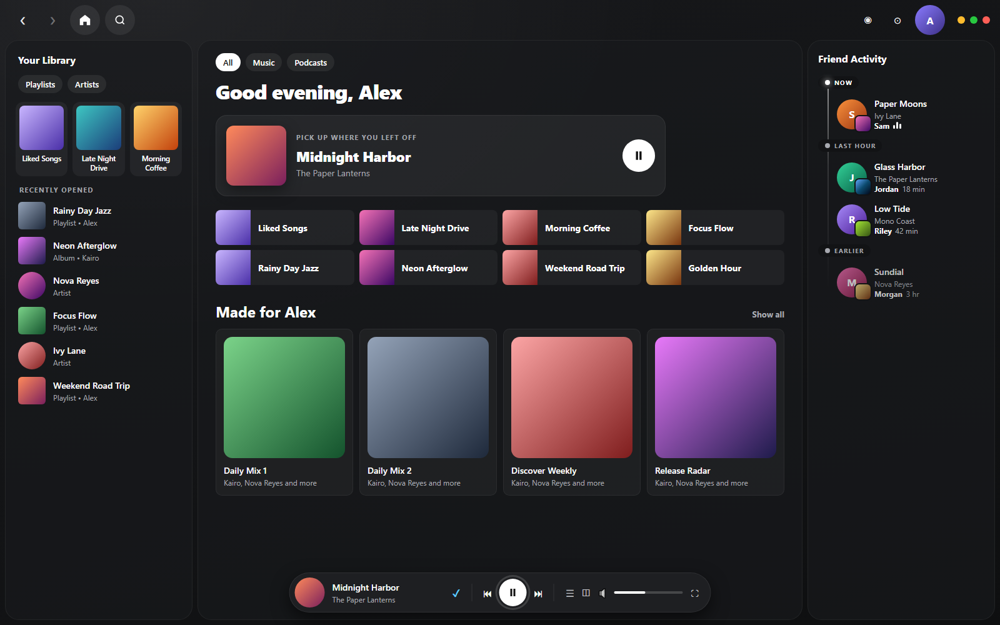
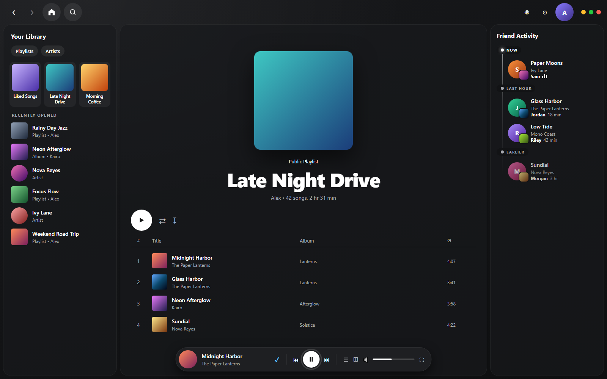
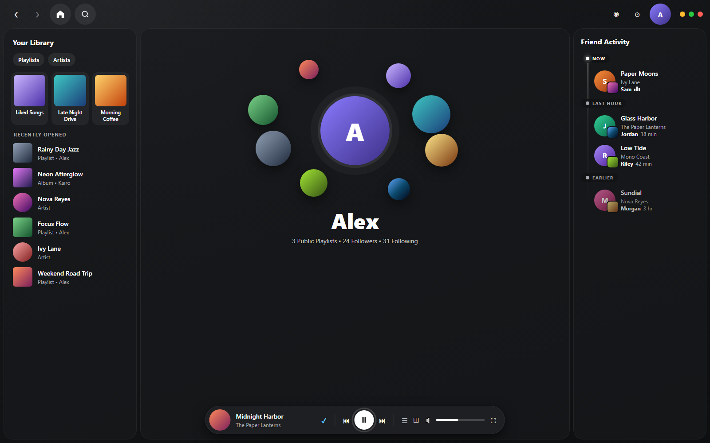
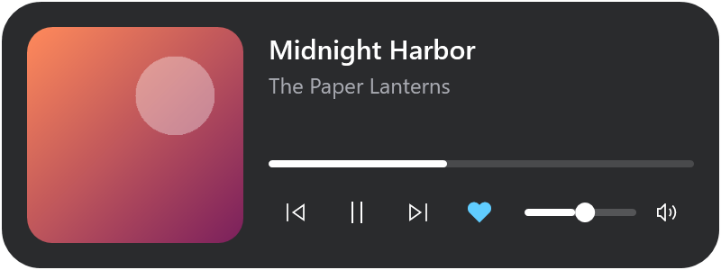

# Fumefy for Spotify

A dark, smoke-gray theme and redesign for the **Spotify desktop app on Windows**, with a floating player,
a friend-activity timeline, rounded one-piece window, a taskbar mini player and a desktop widget.

Fumefy does not touch Spotify's files. It starts Spotify with its local developer port and injects a
stylesheet and a small script while the app runs. Close Spotify, open it normally, and it is stock Spotify again.



> Screenshots use made-up songs, artists and generated covers.

## Features

- **Smoke-gray "Acrylic" theme** with frosted panels and a single, consistent accent.
- **One-piece rounded window**: Spotify's title strip is removed; minimize / maximize / close sit at the top right.
  Drag from the grip or the top bar, resize from any edge, a size readout appears while resizing.
- **Floating capsule player**: song, controls and the right-hand buttons in one pill; progress ring around play;
  long titles scroll; the "Playing on another device" pill slides open next to the device button.
- **Home**: a greeting and a big "Pick up where you left off" card, larger cards on the shelves.
- **Library**: pinned (or most recent) items as big tiles, the rest as a tidy list.
- **Friend activity** as a timeline (Now / Last hour / Earlier) with album covers on each entry.
- **Playlists** with a large centered cover; **artists** in a rounded banner card; **profile** with your top
  artists orbiting your picture.
- **Settings** with a sticky section menu on the left.
- Liked songs and switched-on buttons (shuffle, repeat) show in a clear accent color.
- **Taskbar mini player**: lives inside the Windows taskbar next to the clock: cover, title, like, previous /
  play / next, volume (click the speaker for a slider, or scroll on the player).
- **Desktop widget**: a bigger player card on your desktop; drag it anywhere, it remembers its place.
- Both widgets can be switched on and off from the Fumefy menu inside Spotify (palette icon, or `Ctrl+Alt+T`).
- **Starts with Windows** in place of Spotify's own autostart: Spotify opens minimized and already themed.
  The installer asks, and you can switch it any time in the Fumefy menu. Turning it off gives Spotify its own
  autostart back exactly as it was.
- **Updates itself**: every start checks GitHub for a newer release and installs it; a small pill in Spotify tells you
  what changed. If a new version comes out while Spotify is open, the pill offers a one-click restart.

| Playlist | Profile |
|---|---|
|  |  |

| Desktop widget | Taskbar player |
|---|---|
|  |  |

## Install

Requirements: Windows 10 or 11, Spotify from the **Microsoft Store** or **spotify.com**, and
[Node.js](https://nodejs.org) 22 or newer (the installer offers to install it with `winget`).

**One line** (PowerShell):

```powershell
irm https://raw.githubusercontent.com/lyusufdeniz/fumefy-spotify/main/install.ps1 | iex
```

**Or manually**: download the latest release zip, extract it, and run

```powershell
powershell -ExecutionPolicy Bypass -File install.ps1
```

The installer copies Fumefy to `%LOCALAPPDATA%\Fumefy` and adds a **Spotify (Fumefy)** shortcut to the Start menu
and the desktop. Its icon is the Spotify icon from your own installation, recolored smoke gray (Spotify's logo is
not distributed with this project). Always open Spotify with that shortcut to get the theme.

## Update

Nothing to do: each time you start Fumefy it checks the latest
[release](https://github.com/lyusufdeniz/fumefy-spotify/releases) and updates itself before Spotify opens.
To update by hand, run `update.ps1` in `%LOCALAPPDATA%\Fumefy`.

## Uninstall

Run `uninstall.ps1` in `%LOCALAPPDATA%\Fumefy`. It stops Fumefy, removes the shortcuts, the startup entry and the folder
(Spotify's own autostart setting is restored).
Spotify is left as it was.

## How it works

- `start.ps1` restarts Spotify with `--remote-debugging-port=9222` and runs `inject.mjs` with Node.js.
- `inject.mjs` connects over the Chrome DevTools Protocol and injects `theme/mod.css`, the per-part designs in
  `theme/*/` and `theme/mod.js`. It also starts two small PowerShell helpers:
  - `window.ps1` shapes the window (rounded region, cut title strip, custom move / resize / maximize),
  - `tray.ps1` draws the taskbar player and the desktop widget (WPF) and sends their button presses back.
- Album covers in the friend panel come from Spotify's public oEmbed endpoint.

**Security note:** while Fumefy runs, Spotify's DevTools port listens on `127.0.0.1` only, and because
`--remote-allow-origins` is not set, websites in your browser cannot connect to it. Other programs running on your
own PC could, the same as with any app started with a debugging port.

## Develop

```powershell
.\start.ps1 -Watch
```

runs everything in the console and live-reloads the theme on every save. Designs are plain CSS files with a
metadata comment on the first line; when a folder has more than one, the Fumefy menu lets you pick between them.

## Disclaimer

Fumefy is an independent, unofficial project. It is not affiliated with, endorsed by, or connected to Spotify AB.
"Spotify" is a trademark of Spotify AB. Use at your own risk; Spotify updates may change the app and break parts
of the theme until Fumefy is updated.

## License

[MIT](LICENSE)
